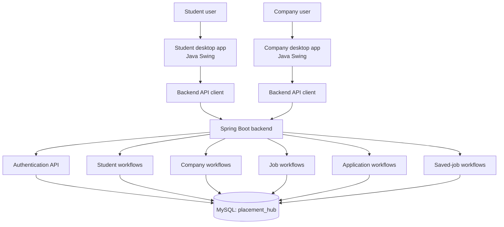

# Campus Placement Management System — Placement Hub

A Java-based campus placement management system designed to connect students and companies through a student desktop application, a company desktop application, and a Spring Boot backend.

> **Project status:** In development  
> **Repository:** [Campus-placement-management-system](https://github.com/navaneethkrishna259/Campus-placement-management-system)

## Overview

Placement Hub is intended to help students discover and save job opportunities, apply for jobs, and follow application and interview information. Companies can use the company application to manage job-related workflows and applications. Both desktop applications communicate with the backend API, which handles application workflows and persistence.

## Main Components

- **Student application** — Java Swing desktop client for student login and student-facing placement features.
- **Company application** — Java Swing desktop client for company login and company-facing placement workflows.
- **Backend API** — Spring Boot application exposing authentication, student, company, job, application, and saved-job APIs.
- **Database** — MySQL database named `placement_hub`, with tables for students, companies, jobs, applications, and saved jobs.

## Technology Stack

- Java
- Java Swing
- Spring Boot
- Maven
- MySQL
- JDBC / MySQL Connector


## Architecture



## Features

The project structure includes components for:

- Student login and registration workflows
- Company login and registration workflows
- Student and company profiles
- Job listing and job management
- Applying to jobs
- Tracking application status
- Scheduling interview details
- Saving and retrieving jobs
- Backend session handling and API responses

Feature availability depends on the current implementation of each workflow.

## Repository Structure

```text
Campus-placement-management-system/
├── company-app/             # Company Java Swing desktop application
│   ├── pom.xml
│   └── src/main/java/
├── database/
│   └── schema.sql           # MySQL database schema
├── placement-backend/       # Spring Boot REST API
│   ├── pom.xml
│   └── src/main/
│       ├── java/
│       └── resources/
│           └── application.properties
├── student-app/             # Student Java Swing desktop application
│   ├── pom.xml
│   └── src/main/java/
├── pom.xml                  # Root Maven project configuration
└── .gitignore
```

## Requirements

Install the following before running the project:

- JDK version compatible with the project's Maven configuration
- Maven (if it is not provided through the Maven Wrapper)
- MySQL Server
- An IDE such as IntelliJ IDEA, Eclipse, or VS Code with Java support

Check your installed Java and Maven versions:

```bash
java -version
mvn -version
```

## Setup

### 1. Clone the repository

```bash
git clone https://github.com/navaneethkrishna259/Campus-placement-management-system.git
cd Campus-placement-management-system
```

### 2. Create the MySQL database

Review `database/schema.sql` before executing it. Run the schema using MySQL only after confirming it will not overwrite or remove data you need.

For example, from a MySQL client:

```sql
CREATE DATABASE IF NOT EXISTS placement_hub;
```

Then execute the project's schema file against that database. Do not use production or personal data for local testing.

### 3. Configure database credentials

The backend configuration is in:

`placement-backend/src/main/resources/application.properties`

The project configuration uses environment variables for the database connection:

- `DB_URL` — optional; defaults to the local `placement_hub` database URL
- `DB_USERNAME` — optional; defaults to `root`
- `DB_PASSWORD` — required

Do not commit database passwords, access tokens, or personal data to GitHub. Set environment variables in your own terminal or development environment.

**PowerShell example** (replace the values locally; do not share them publicly):

```powershell
$env:DB_URL = "jdbc:mysql://localhost:3306/placement_hub?useSSL=false&serverTimezone=UTC&allowPublicKeyRetrieval=true"
$env:DB_USERNAME = "root"
$env:DB_PASSWORD = "YOUR_LOCAL_MYSQL_PASSWORD"
```

These variables apply to the current PowerShell session.

### 4. Run the backend

Open a terminal in the backend folder:

```bash
cd placement-backend
mvn spring-boot:run
```

The configured server port is `8080`. Keep the terminal open while using the desktop applications.

### 5. Run the desktop applications

Open each application in your IDE and run its main class:

- Student application: `com.placementhub.student.StudentApplication`
- Company application: `com.placementhub.company.CompanyApplication`

Alternatively, build each Maven module from its directory:

```bash
mvn clean package
```

Follow any additional configuration or dependency instructions in each module's `pom.xml`.

## Database Tables

The provided schema defines these tables:

| Table | Purpose |
|---|---|
| `students` | Student account/profile records |
| `companies` | Company account/profile records |
| `jobs` | Job listings posted by companies |
| `applications` | Student job applications and interview/status details |
| `saved_jobs` | Jobs saved by students |

## Collaborating

1. Ask the repository owner to invite your GitHub account as a collaborator.
2. Accept the GitHub invitation.
3. Clone the repository and create a branch for your changes.
4. Commit and push your branch, then open a pull request if the team uses pull requests.

```bash
git checkout -b feature/your-feature
git add .
git commit -m "Describe your changes"
git push -u origin feature/your-feature
```

Before committing, check that no credentials, local database files, generated build outputs, or personal data are included.

## Security Notes

- Keep `DB_PASSWORD` and all other credentials outside version control.
- Use separate local database credentials for each developer.
- Avoid committing real student/company records or database exports.
- Passwords for student and company accounts should be securely hashed by the application; do not store plain-text passwords.
- A private GitHub repository limits visibility but should not be treated as a secure place for secrets.

## Contributing

Contributions and improvements are welcome from authorized collaborators. Please keep changes focused, test your changes locally, and document new configuration requirements.

## License

No license has been specified yet. Unless a license is added, standard copyright restrictions apply and reuse permissions are not automatically granted.
